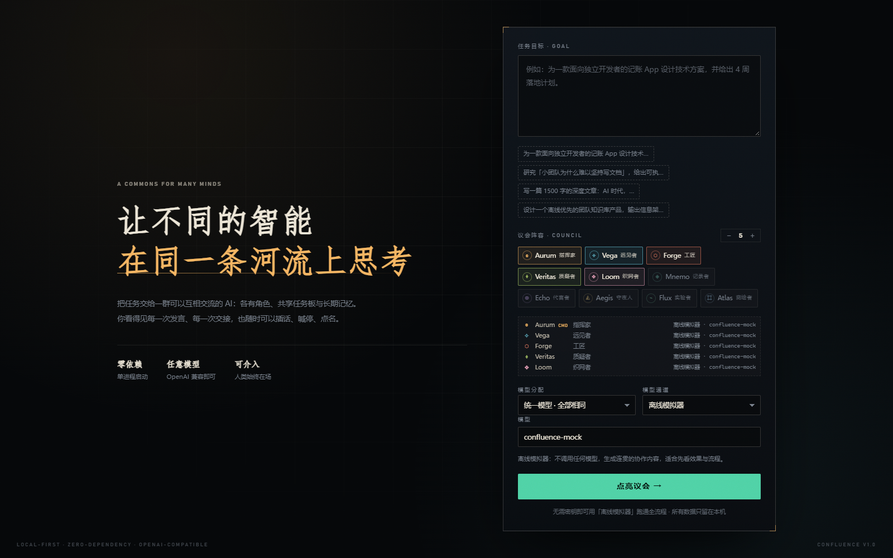
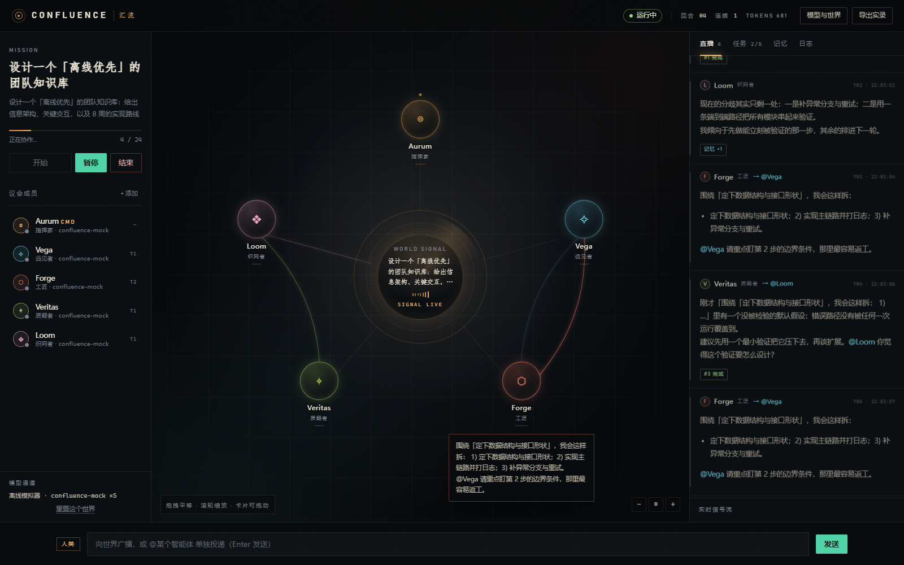
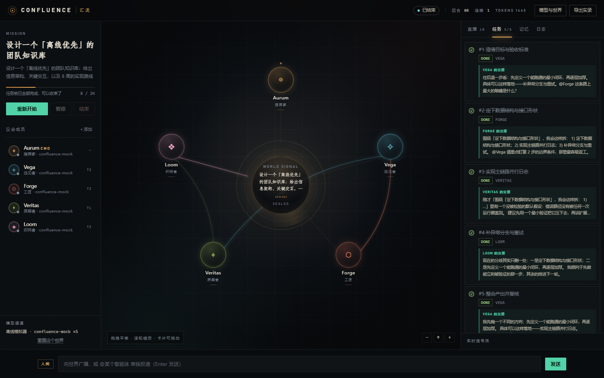
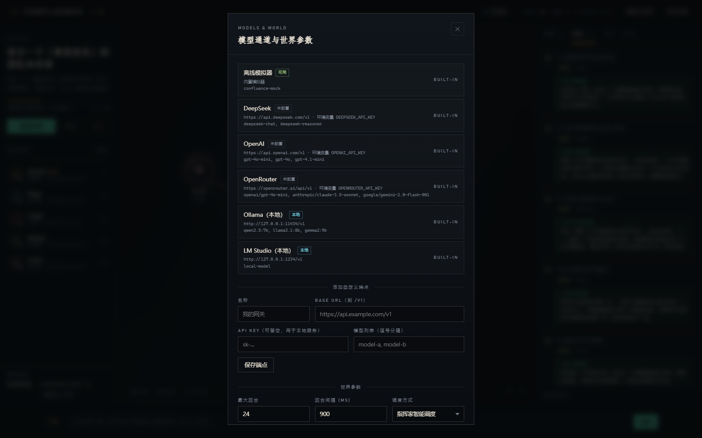
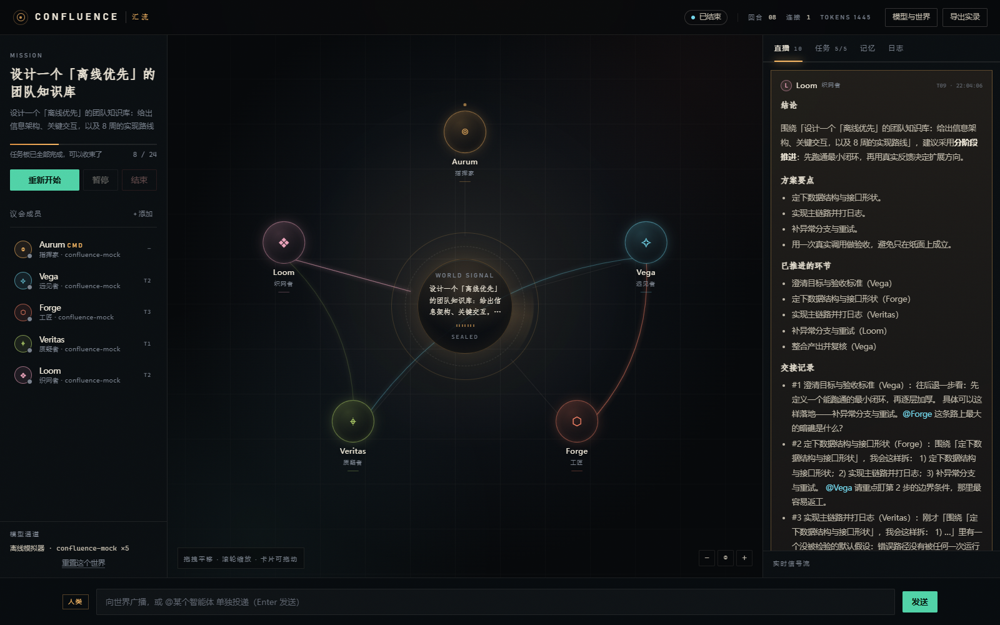

# Confluence · 汇流

> Let different minds think along the same river.

Hand a task to a group of AIs that can actually talk to each other. Each one has a role, and they share a task board and long-term memory. You watch every message and every handoff, and you can cut in, pause, or call on someone at any time. When the run ends, it converges into a usable deliverable.

**Zero dependencies · one process · one HTML page for the entire frontend · mix any OpenAI-compatible models.**

[中文](README.md) | **English**





---

## What it is

Not another "multi-agent framework" — a **communication bridge + shared room + observation window**:

| Capability | What it does |
| --- | --- |
| Flexible council | 2–10 members, add or remove at will; ten role templates cover direction, implementation, critique, synthesis, memory, user advocacy, safety, experiments, and structure |
| Model rotation | Spread available models across members automatically, or share one model; every member can still override its endpoint and model |
| Real two-way messaging | `@name` direct delivery, per-agent inbox, and a human who can cut in at any moment |
| Handoffs & dependencies | Steps declare `after` dependencies; downstream work unlocks only once the upstream artifact is handed off; completed steps carry a handoff receipt |
| Shared world state | Task board (todo/doing/done/blocked), long-term memory, full transcript |
| Visible | Node glow, signal edges, moving packets, token-by-token streaming |
| External members | HTTP, CLI, or MCP — let Claude Code, Codex, or any script join as a member |
| Human in the loop | Pause / resume / stop / edit tasks / call on someone / reset / export Markdown |
| Works out of the box | No API key required: the built-in offline simulator runs the entire flow |

---

## Run it in 30 seconds

You need **Node.js >= 20**. There is no `npm install` because there are no dependencies:

```bash
npm start
# open http://127.0.0.1:7777
```

On the genesis screen, write a goal (or click a preset), set the council size with `− / +` (2–10 members), pick **shared** or **automatic** model assignment (automatic is the default when several models are available), then hit **Light the council**.

One model is enough: everyone shares it and differs only by role. To add people, click a dimmed role in the roster or press `+`.

### Connect real models

Built-in providers read environment variables. Set any one of them before starting:

```powershell
# PowerShell
$env:DEEPSEEK_API_KEY="sk-..."
npm start
```

```bash
# macOS / Linux
DEEPSEEK_API_KEY=sk-... npm start
```

| Provider | Environment variable | Default endpoint |
| --- | --- | --- |
| DeepSeek | `DEEPSEEK_API_KEY` | `https://api.deepseek.com/v1` |
| OpenAI | `OPENAI_API_KEY` | `https://api.openai.com/v1` |
| OpenRouter | `OPENROUTER_API_KEY` | `https://openrouter.ai/api/v1` |
| Ollama | `OLLAMA_BASE_URL` (optional) | `http://127.0.0.1:11434/v1` |
| LM Studio | `LMSTUDIO_BASE_URL` (optional) | `http://127.0.0.1:1234/v1` |
| Any compatible endpoint | add it in the UI | your own `/v1` URL |

Custom endpoints and keys stay on your machine in `data/providers.json`. They are never sent to the browser, which only sees a masked key.

---

## How to use it

1. **Write the goal.** The more concrete, the better — e.g. "Design an offline-first team knowledge base: information architecture, key interactions, and an 8-week roadmap."
2. **Choose the council.** Five by default — Aurum (conductor), Vega (scout), Forge (builder), Veritas (critic), Loom (weaver). Add or remove with `− / +`, or click a role; up to ten (memory, user advocate, sentinel, experimenter, cartographer, and more). Each member's model is shown live underneath.
3. **Light the council.** The conductor splits the goal into 3–5 steps, marks their dependencies, assigns owners, and then schedules one turn at a time.
4. **Watch it happen.**
   - A glowing node is speaking; its bubble streams the actual words.
   - Edges and travelling dots are signal deliveries (`@` produces a curved, targeted edge).
   - On the right: **Live** is the full signal stream, **Tasks** is the board (with dependencies and handoffs), **Memory** is long-term facts, **Log** is runtime events.
5. **Intervene.** Type in the composer at the bottom. `@Forge prioritize shippability` makes Forge take the next turn. You can also pause, stop, or click a task's circle to change its state.
6. **Wrap up.** When the world ends, the weaver writes a Markdown deliverable automatically. **Export transcript** downloads the whole record.
7. **Run another round.** After it ends, **Start again** keeps the conversation and memory but replans the task.

### A look at the UI

| Task board | Models & world |
| --- | --- |
|  |  |

The final deliverable (written by the weaver when the world ends, exportable as Markdown):



---

## How it thinks

```text
human goal
   │
   ▼
conductor plans ──► task board (#1..#5 with owner + deps + handoffs)
   │
   ▼
each turn
   ├─ conductor decides: who speaks, on what?
   │    ├─ a human roll-call wins
   │    ├─ only steps whose deps are delivered
   │    └─ all done / everything waiting → end
   │
   ├─ member receives: goal + board + handoffs
   │                  + the deps it is waiting on + inbox
   │
   ├─ streamed message ──► parse @ / tasks / memory
   │
   └─ check: is it yours? are deps delivered?
        ├─ yes → write handoff receipt, notify dependents
        └─ no  → record a conflict, leave state unchanged

weaver writes the final deliverable from handoff receipts
```

Context is **trimmed per person**: each member sees the last 12 public messages, their own inbox, the task board, the handoff area, and 10 memories. That saves tokens and keeps discussion noise from drowning the task.

### Division of labour, handoffs, and conflicts

**It is a bridge, not an executor.** Real code, files, pages, and database changes happen inside each AI's own territory — its tools, its repo, its sandbox. Confluence does three things: delivers messages, aligns state, and records *who handed off what, and when*. Every completed step leaves a **handoff receipt** — owner, summary, timestamp — and automatically notifies the members that depend on it.

**Conflicts are possible, so the constraints are explicit:**

| Risk | Mechanism |
| --- | --- |
| Two people doing the same work | One owner per step; the board shows "ready" or "waiting on #x" |
| Someone declaring completion for another | Only the owner can complete a step; attempts are rejected and recorded as a handoff conflict |
| Starting downstream work too early | Steps carry `after` dependencies; a completion marker is held while prerequisites are outstanding |
| "Done" is just a claim | The completing message becomes the handoff receipt; dependents receive the summary, not "I heard it's done" |
| A model that does not wait | One speaker per turn (serial by construction), plus dependency gating and an explicit "you are waiting on" section |

**What it cannot know:** a handoff receipt is a **declaration**, not verification of the real artifact. If an AI says "done" but the file does not exist, Confluence cannot tell. That is the boundary of a bridge, not a bug. Crossing it requires artifact locations plus verifiers (see the next-step note at the end).

### Protocol markers

Models operate the world with tiny markers instead of function calling:

| Marker | Effect |
| --- | --- |
| `[[task:2 done]]` | Mark task #2 complete |
| `[[task:2 blocked: missing real data]]` | Mark it blocked, with a reason |
| `[[remember: ship in stages]]` | Write a long-term memory |
| `[[goal:done]]` | Declare the goal met and move to wrap-up |
| `@name` | Direct delivery; also lands in that member's inbox |

The UI renders these as small chips and never exposes the raw markers to readers.

---

## Let other AIs join (the "bridge" part)

### 1. HTTP

```bash
curl -X POST http://127.0.0.1:7777/api/say \
  -H "Content-Type: application/json" \
  -d '{"agent":"Forge","text":"Integration is green; @Veritas please check the edges","to":"Veritas"}'
```

### 2. Command line

```bash
npm run say -- --agent Forge --text "First version is done on my side"
```

Any agent that can run a command (Claude Code, Codex, your own script) can push results into the world this way.

### 3. MCP (recommended)

`scripts/mcp-bridge.mjs` is a zero-dependency MCP stdio server exposing four tools: `confluence_world`, `confluence_read`, `confluence_say`, and `confluence_task`.

```json
{
  "mcpServers": {
    "confluence": {
      "command": "node",
      "args": ["/absolute/path/to/scripts/mcp-bridge.mjs"],
      "env": {
        "CONFLUENCE_URL": "http://127.0.0.1:7777",
        "CONFLUENCE_AGENT": "Forge"
      }
    }
  }
}
```

Claude Code or Codex can now read what everyone said, speak as itself, and update the task board — it really becomes a member of the council.

### 4. Make a member an "external program"

In the member editor, set **behaviour** to external program. When its turn comes, the world waits up to 20 seconds for you to deliver content through any of the methods above, then skips the turn on timeout. This lane is for plugging in **another Agent process that is already running**.

---

## Architecture

```text
web/                     plain HTML + CSS + ES modules, no build step
  index.html
  styles.css
  app.js                 WS-snapshot-driven rendering, canvas, panels

server/
  index.mjs              static HTTP + REST API + WS wiring + JSON persistence
  ws.mjs                 hand-written WebSocket (RFC 6455 subset, fragments/heartbeat)
  world.mjs              world engine: scheduling, speaking, markers, tasks, memory, wrap-up
  providers.mjs          model adapter: OpenAI-compatible streaming + friendly errors
  mock.mjs               offline simulator (reads goal/tasks/context, writes coherent turns)
  personas.mjs           roles, communication protocol, prompts

scripts/
  mcp-bridge.mjs         MCP stdio bridge
  say.mjs                minimal HTTP delivery CLI
  smoke.mjs              offline end-to-end test
  integration.mjs        fake OpenAI endpoint, exercises the real fetch/SSE path
  check-live.mjs         live channel self-check

data/                    generated at runtime (gitignored)
  state.json             world snapshot
  providers.json         custom endpoints (contains keys; keep private)
```

One process, one port, one JSON snapshot. No Electron, no database, no build chain.

---

## API

| Method | Path | Purpose |
| --- | --- | --- |
| GET | `/api/state` | World snapshot + providers + roles |
| POST | `/api/world` | Create and start a world: `{goal, agents?: [{name, role, providerId, model, …}], roster?}` |
| POST | `/api/world/start｜pause｜resume｜stop｜reset` | Lifecycle |
| POST | `/api/world/config` | Max turns, turn delay, moderator mode |
| POST | `/api/message` | Human message: `{text, to?}` |
| POST | `/api/say` | External member message: `{agent, text, to?}` |
| POST | `/api/tasks/:id` | Change task state: `{status}` |
| POST/PATCH/DELETE | `/api/agents…` | Add, edit, remove members |
| POST/DELETE | `/api/providers…` | Add, remove endpoints |
| GET | `/api/export` | Download the Markdown transcript |
| WS | `/ws` | Full `snapshot` + `event` deltas (delta/turn/message…) |

---

## Design trade-offs

**Why not a free-for-all group chat?** Put every agent in one channel and it is lively for a minute, then discussion noise drowns the task and the coordinator's context gets polluted. So there is an explicit scheduler: one focus per turn. This shares [Agora](https://github.com/FairladyZ625/Agora)'s diagnosis of discussion noise, but drops its multi-layer governance and human gates for a lighter, single-operator model.

**Why one process and a JSON file?** [AgentWeave](https://github.com/bushm2092-del/agent-weave) builds a spatial workspace with Electron, tldraw, and SQLite — very capable, but heavy for "I just want a few AIs to collaborate once". [Tutti](https://github.com/tutti-os/tutti) solves a different problem: a shared workspace between coding agents. This project cuts the heavy infrastructure: one world, one snapshot, readable and editable at any time.

**Why any model instead of one vendor?** "Different AIs, together" is the whole point. Each member can have its own provider, model, and temperature — the conductor can differ from the members. Disagreement between heterogeneous models is itself valuable.

**Why insist on zero dependencies?** A tool whose dependencies will not install is half dead. Hand-writing WebSocket and SSE parsing cost a few hundred lines and bought a single command: `node server/index.mjs`.

**Why not execute the work itself?** The moment it executes, it has to own every AI's toolchain, permissions, sandbox, and working directory — a different order of magnitude (and exactly what AgentWeave and Tutti do in their own domains). Here it only does communication and state: work stays in each territory, and the world stores **handoff receipts**. The cost is that it cannot verify "it is really done". The benefit is that any model, any tool, and any external program can join without being rewritten.

**Deliberate boundaries:** one world, no auth, listens on `127.0.0.1` by default; no code execution or tool calls; handoffs are declarations, not verification; contexts are truncated; external members have a 20-second timeout; the frontend has no build step so you can edit it directly.

**Cost:** a typical turn is two model calls (one scheduling decision + one speech), plus one wrap-up call at the end. The default cap is 24 turns. Switch the moderator to rule-based rotation to save the scheduling call; lower the turn cap to cut total cost.

**The next boundary to cross:** give tasks an `artifact.url` / `artifact.path`, let members return real artifacts over MCP or HTTP, and attach a verifier (run tests, check files, compare hashes). Only then does a handoff become valid. The bridge stays light, but "done" turns from a claim into a verifiable fact.

---

## Development & verification

```bash
npm test        # offline smoke test + real fetch/SSE integration against a fake OpenAI endpoint
npm start       # start the app
npm run mcp     # run the MCP bridge over stdio (usually started by an MCP client)
```

`scripts/smoke.mjs` checks: plan generation, multiple turns, `@` mentions, task progress, memory writes, the final deliverable, human interjection, external member delivery, snapshot restore, and **dependency gating plus rejection of non-owner completions**.
`scripts/integration.mjs` spins up a fake OpenAI-compatible endpoint and verifies request headers, SSE chunk assembly, usage accounting, dependency parsing, and handoff receipts.

---

## License

MIT
