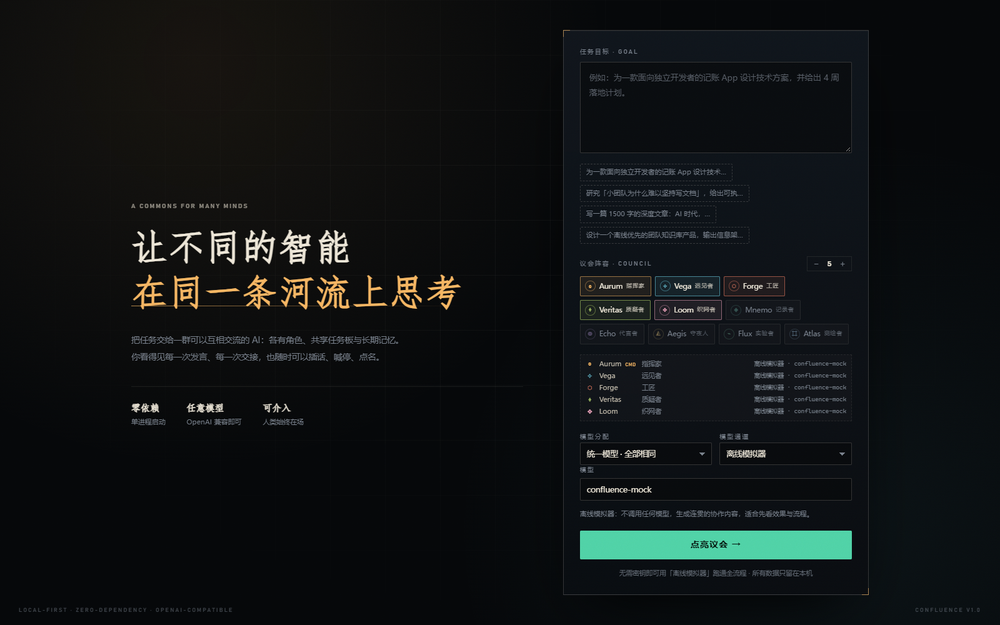
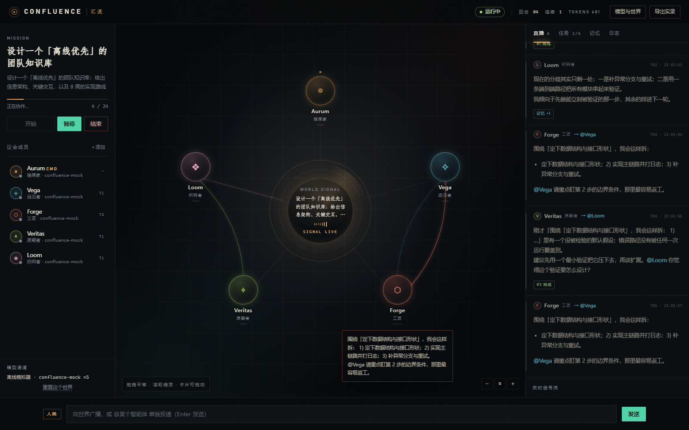
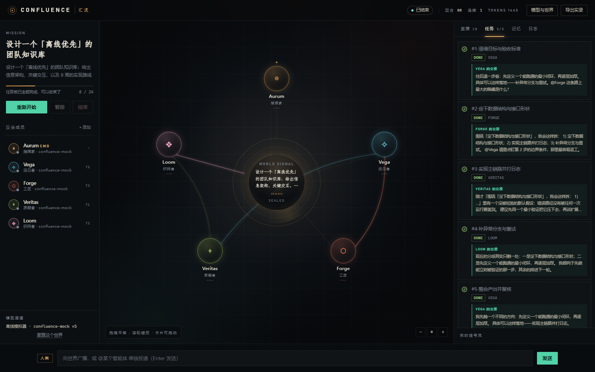
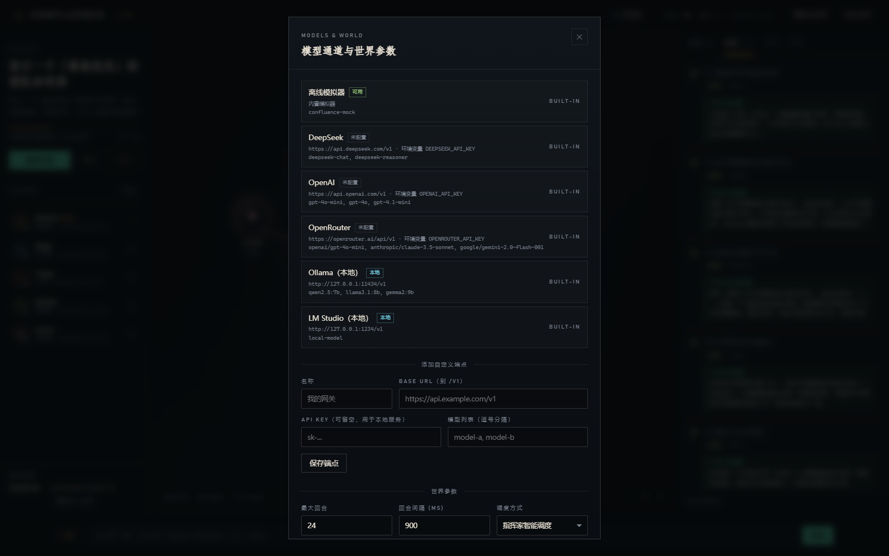
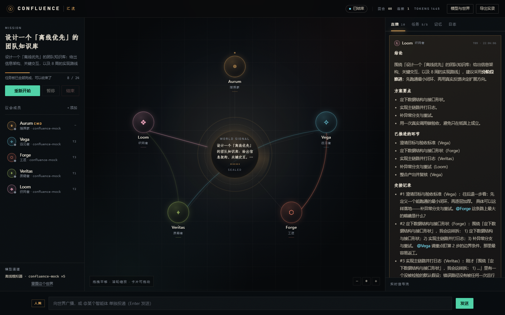

# 汇流 · CONFLUENCE

> 让不同的智能，在同一条河流上思考。

**中文 | [English](README.en.md)**

把任务交给一群**可以互相交流**的 AI。它们各有角色、共享任务板与长期记忆；你看得见每一次发言、每一次交接，也随时可以插话、喊停、点名。跑完自动收敛成一份可用的交付物。

**零依赖 · 单进程 · 一个 HTML 页面就是全部前端 · 任意 OpenAI 兼容模型可混用。**





---

## 这是什么

不是又一个"多 Agent 框架"，而是一座**通讯桥 + 协作室 + 观察窗**：

| 能力 | 说明 |
| --- | --- |
| 可伸缩的议会 | 2–10 位成员自由增删；十种角色模板覆盖方向、实现、质疑、收敛、记忆、代言、安全、实验、结构 |
| 模型轮转 | 自动把可用模型分给不同成员，也可以统一模型；每个成员还能单独指定端点与模型 |
| 真正的双向通讯 | `@某人` 定向投递、私信收件箱、人类随时插话 |
| 交接与依赖 | 环节有先后依赖；前置产出交付后才解锁；完成记录带"交接凭据" |
| 共享世界状态 | 任务板（todo/doing/done/blocked）、长期记忆、完整实录 |
| 看得见 | 节点辉光、信号连线、流动的数据包、逐字流式输出 |
| 外部程序入会 | HTTP、CLI、MCP 三种方式让 Claude Code、Codex、脚本成为成员 |
| 人类始终在场 | 暂停 / 继续 / 结束 / 改任务 / 点名 / 重置 / 导出 Markdown |
| 开箱即用 | 没有 API Key 也能用内置「离线模拟器」跑完整流程 |

---

## 30 秒跑起来

需要 **Node.js >= 20**（不需要 `npm install`，本项目没有任何依赖）：

```bash
npm start
# 打开 http://127.0.0.1:7777
```

在创世界面写下目标（或点一个示例），用 `− / +` 调整议会规模（2–10 位），模型分配选「统一」或「自动」（有多个可用模型时默认自动轮转给不同成员），点**点亮议会**。

只有一个模型也能跑：所有成员共用它，只是角色不同；想加人就直接点阵容里灰着的角色，或按 `+`。

### 接真实模型

内置通道读取环境变量，启动前设置任意一个即可：

```powershell
# PowerShell
$env:DEEPSEEK_API_KEY="sk-..."
npm start
```

```bash
# macOS / Linux
DEEPSEEK_API_KEY=sk-... npm start
```

| 通道 | 环境变量 | 默认端点 |
| --- | --- | --- |
| DeepSeek | `DEEPSEEK_API_KEY` | `https://api.deepseek.com/v1` |
| OpenAI | `OPENAI_API_KEY` | `https://api.openai.com/v1` |
| OpenRouter | `OPENROUTER_API_KEY` | `https://openrouter.ai/api/v1` |
| Ollama | `OLLAMA_BASE_URL`（可选） | `http://127.0.0.1:11434/v1` |
| LM Studio | `LMSTUDIO_BASE_URL`（可选） | `http://127.0.0.1:1234/v1` |
| 任意兼容端点 | 界面里添加 | 你的 `/v1` 地址 |

自定义端点与密钥保存在本机 `data/providers.json`，不会回传到浏览器；浏览器只能看到掩码后的 key。

---

## 怎么用

1. **写下目标**：越具体越好，例如「设计一个离线优先的团队知识库：信息架构、关键交互、8 周路线」。
2. **选阵容**：默认五位——Aurum 指挥家、Vega 远见者、Forge 工匠、Veritas 质疑者、Loom 织网者；用 `− / +` 或直接点角色增减，最多十位（记录、代言、守夜、实验、测绘等）。每位成员的模型会实时显示在下方。
3. **点亮议会**：指挥家先把目标拆成 3–5 个环节、标好先后依赖并派活，然后逐轮调度。
4. **看着它发生**：
   - 节点发光 = 正在发言；气泡里是逐字流出的原话；
   - 连线与流动的光点 = 一次信号传递（`@` 会产生弯曲的定向连线）；
   - 右侧「直播」是完整信号流，「任务」是任务板（含依赖与交接），「记忆」是长期事实，「日志」是运行事件。
5. **介入**：底部输入框直接说话；`@Forge 请优先保证可交付性` 会让 Forge 在下一轮接手。也可以暂停、结束、在任务板上点圆圈改状态。
6. **收尾**：世界结束时，织网者会自动写一份 Markdown 交付物；点「导出实录」下载完整记录。
7. **重开一轮**：结束后点「重新开始」，保留对话与记忆，重新拆解任务。

### 界面一瞥

| 任务板 | 模型与世界 |
| --- | --- |
|  |  |

最终交付物（世界结束时由织网者写出，可直接导出 Markdown）：



---

## 它如何"思考"

```text
人类目标
   │
   ▼
指挥家拆解 ──► 任务板（#1..#5，owner + 依赖 + 交接）
   │
   ▼
┌──────────────── 每一轮 ────────────────┐
│ 指挥家决定：谁发言？聚焦什么？          │
│   ├─ 人类点名时，被点名者优先           │
│   ├─ 只派「前置已交付」的环节           │
│   └─ 全部完成 / 都在等 → 收尾           │
│        │                                │
│        ▼                                │
│ 该成员收到：目标 + 任务板 + 交接区      │
│            + 自己在等的依赖 + 私信      │
│        │                                │
│        ▼                                │
│ 流式发言 ──► 解析 @提及 / 任务 / 记忆    │
│        │                                │
│        ▼                                │
│ 校验：本人负责？前置已交付？            │
│   ├─ 通过 → 写入「交接凭据」并通知下游  │
│   └─ 拒绝 → 记为交接冲突，不改变状态    │
└─────────────────────────────────────────┘
   │
   ▼
织网者按各环节的交接凭据写最终交付物
```

上下文是**按人裁剪**的：每个人只看到最近 12 条公开对话、自己的私信、任务板、交接区与 10 条记忆。这既省 token，也避免"讨论噪声淹没任务"。

### 分工、交接与冲突

**它是桥，不是执行器。** 真正的代码、文件、网页、数据库变更发生在各个 AI 自己的领地里（它们的工具、仓库、沙箱）；汇流只负责三件事：把话传到、把状态对齐、把"谁在什么时候交付了什么"记下来。因此每个完成环节都会留下一条**交接凭据**——负责人 + 摘要 + 时间，并自动通知依赖它的下一位成员。

**冲突是可能的，所以显式约束：**

| 风险 | 机制 |
| --- | --- |
| 两个人同时做同一件事 | 每个环节只有一个负责人；任务板会显示"可开始 / 等待 #x" |
| 有人替别人宣告完成 | 只有负责人能标记完成；代完成会被拒绝并记为「交接冲突」 |
| 前置没做就先做后置 | 环节带 `after` 依赖；前置未交付时完成标记会被挂起 |
| 完成是嘴上说的 | 完成的发言同时成为交接凭据；下游收到通知与摘要，而不是"听说做完了" |
| 模型没在等 | 每轮只允许一个人说话（天然串行）；再加上依赖门禁与「你正在等待」提示 |

**它不知道的部分：** 交接凭据是**声明**，不是对真实产物的验证。如果某个 AI 说"我做完了"但文件并不存在，汇流无法分辨。这是"通讯桥"的边界，不是 bug；要跨过它，需要给成员加"产出位置 + 校验器"（见文末的下一步）。

### 发言里的协议标记

模型可以用极轻量的标记操作世界（不依赖 function calling）：

| 标记 | 作用 |
| --- | --- |
| `[[task:2 done]]` | 把任务 #2 标记完成 |
| `[[task:2 blocked: 缺少真实数据]]` | 标记阻塞并附原因 |
| `[[remember: 采用分阶段交付]]` | 写入长期记忆 |
| `[[goal:done]]` | 宣布目标达成，进入收尾 |
| `@名字` | 定向投递，并出现在对方私信里 |

界面会把标记渲染成小徽章，不会把原始标记暴露给读者。

---

## 让别的 AI 加入（这是"桥"的部分）

### 1. HTTP

```bash
curl -X POST http://127.0.0.1:7777/api/say \
  -H "Content-Type: application/json" \
  -d '{"agent":"Forge","text":"接口已联调通过，@Veritas 看下边界","to":"Veritas"}'
```

### 2. 命令行

```bash
npm run say -- --agent Forge --text "我这边完成了第一版"
```

任何能执行命令的智能体（Claude Code、Codex、自写脚本）都能这样把结果投递进世界。

### 3. MCP（推荐）

`scripts/mcp-bridge.mjs` 是一个零依赖的 MCP stdio 服务，提供四个工具：`confluence_world`、`confluence_read`、`confluence_say`、`confluence_task`。

```json
{
  "mcpServers": {
    "confluence": {
      "command": "node",
      "args": ["E:/project4(united)/scripts/mcp-bridge.mjs"],
      "env": {
        "CONFLUENCE_URL": "http://127.0.0.1:7777",
        "CONFLUENCE_AGENT": "Forge"
      }
    }
  }
}
```

这样 Claude Code 或 Codex 就能读到其他人的发言、以自己的身份说话、更新任务板——它真的成为了议会里的一员。

### 4. 把成员设成「外部程序」

在成员编辑里把「行为方式」改成外部程序：轮到它时，世界会等待最多 20 秒，等你用上面任一方式投递内容；超时则跳过本轮。这条通道适合把**另一个正在运行的 Agent 进程**接进来。

---

## 架构

```text
web/                     纯 HTML + CSS + ES Module，无构建步骤
  index.html
  styles.css
  app.js                 WS 快照驱动的渲染、画布、面板

server/
  index.mjs              HTTP 静态服务 + REST API + WS 接线 + JSON 持久化
  ws.mjs                 手写 WebSocket（RFC6455 子集，含分片/心跳）
  world.mjs              世界引擎：调度、发言、标记、任务、记忆、收尾
  providers.mjs          模型适配层：OpenAI 兼容流式 + 错误提示
  mock.mjs               离线模拟器（读目标/任务/上下文，产出连贯内容）
  personas.mjs           角色设定、交流协议、提示词

scripts/
  mcp-bridge.mjs         MCP stdio 桥
  say.mjs                最小 HTTP 投递 CLI
  smoke.mjs              离线端到端测试
  integration.mjs        假 OpenAI 端点，验证真实 fetch/SSE 路径
  check-live.mjs         实时通道自检

data/                    运行时生成（已 gitignore）
  state.json             世界快照
  providers.json         自定义端点（含密钥，注意保密）
```

一个进程、一个端口、一份 JSON 快照。没有 Electron、没有数据库、没有构建链。

---

## API

| 方法 | 路径 | 作用 |
| --- | --- | --- |
| GET | `/api/state` | 世界快照 + 提供商 + 角色 |
| POST | `/api/world` | 创建世界并启动 `{goal, agents?: [{name, role, providerId, model, …}], roster?}` |
| POST | `/api/world/start｜pause｜resume｜stop｜reset` | 生命周期 |
| POST | `/api/world/config` | 改最大回合、间隔、调度方式 |
| POST | `/api/message` | 人类发言 `{text, to?}` |
| POST | `/api/say` | 外部成员发言 `{agent, text, to?}` |
| POST | `/api/tasks/:id` | 改任务状态 `{status}` |
| POST/PATCH/DELETE | `/api/agents…` | 成员增改删 |
| POST/DELETE | `/api/providers…` | 端点增删 |
| GET | `/api/export` | 下载 Markdown 实录 |
| WS | `/ws` | `snapshot` 全量状态 + `event` 增量（delta/turn/message…） |

---

## 设计取舍

**为什么不自由群聊？** 把所有 Agent 丢进一个频道，短期很热闹，长期是噪声淹没任务、协调者上下文被污染。所以这里保留一个显式的调度者：每一轮只有一个焦点。这与 [Agora](https://github.com/FairladyZ625/Agora) 对"讨论噪声"的判断一致，但去掉了它的多层治理与人工闸门，换成更轻的单人可介入模型。

**为什么单进程 + JSON？** [AgentWeave](https://github.com/bushm2092-del/agent-weave) 用 Electron + tldraw + SQLite 做空间工作区，能力很全，但对"只想让几个 AI 协作一次"的人来说太重；[Tutti](https://github.com/tutti-os/tutti) 解决的是编码 Agent 之间共享工作区。这里选择砍掉重型基础设施：一个世界、一份快照、随时可读可改。

**为什么支持任意模型而不是绑定一家？** "不同的 AI 聚在一起"才是这个项目的题眼。每个成员可以有自己的 provider / model / temperature，指挥家也可以和成员不同——异质模型的分歧本身就有价值。

**为什么坚持零依赖？** 装不上依赖的工具有一半的寿命。手写 WebSocket 与 SSE 解析多花了几百行，换来 `node server/index.mjs` 就能跑。

**为什么不自己执行任务？** 一旦它开始执行，就要接管每个 AI 的工具链、权限、沙箱与工作目录，那是另一个量级的工程（也是 AgentWeave / Tutti 在各自领域做的事）。这里只做通讯与状态：产出留在各自的领地，世界只保存**交接凭据**。代价是它无法验证"真的做完了"；收益是任何模型、任何工具、任何外部程序都能接入，而不需要改造它们。

**边界（有意的）**：单世界、无鉴权、默认只监听 `127.0.0.1`；不执行代码、不调用工具；交接是声明而非验证；上下文会截断；外部成员有 20 秒超时；前端没有构建步骤，方便直接改。

**成本**：每个回合通常是两次模型调用（一次调度决策 + 一次发言），结束时再加一次收尾产出。默认上限 24 回合；把「调度方式」改成规则轮转可以省掉调度那次调用，把最大回合调小可以压总成本。

**下一步可以跨过的边界**：给任务加 `artifact.url / artifact.path`，让成员用 MCP 或 HTTP 回传真实产物，再挂一个校验器（跑测试、检查文件、比对 hash）；通过后交接才成立。这样"桥"仍然轻，但"完成"从声明变成了可验证的事实。

---

## 开发与验证

```bash
npm test        # 离线冒烟 + 假 OpenAI 端点的真实 fetch/SSE 集成测试
npm start       # 启动
npm run mcp     # 以 stdio 方式跑 MCP 桥（通常由 MCP 客户端启动）
```

`scripts/smoke.mjs` 会验证：计划生成、多轮发言、`@` 提及、任务推进、记忆写入、最终交付物、人类插话、外部成员投递、快照恢复、**依赖门禁与非负责人完成拦截**。
`scripts/integration.mjs` 起一个假的 OpenAI 兼容端点，验证请求头、SSE 分片拼接、`usage` 统计、依赖解析与交接凭据。

---

## License

MIT
